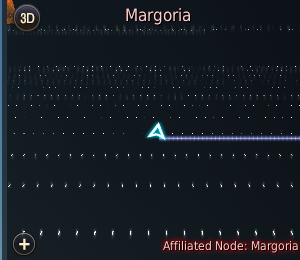

# BDO Sea Assistant

[](https://github.com/he11fireUA/bdo-sea-assistant/actions/workflows/ci.yml)

A read-only Windows screen assistant for Black Desert Online.

The source code is licensed under the GNU General Public License v3.0 only.
See [LICENSE](LICENSE) and [CONTRIBUTING.md](CONTRIBUTING.md) before submitting changes.
Asset provenance and third-party notices are documented in [ASSET_NOTICES.md](ASSET_NOTICES.md).

The project captures the BDO window through Windows Graphics Capture and analyzes visible UI pixels. It does not send input, read game memory, inject code, hook DirectX, or modify game files.

## Project status

**Public alpha.** The functional core and the modern PySide6 application shell are implemented. Current development is focused on public distribution, release automation, updater installation, and continued field validation—not initial core development.

The production desktop entry point is:

```text
run_modern_app.py
```

### Implemented

- Black Desert window discovery and Windows Graphics Capture integration;
- saved UI calibration with preview, confirmation, retry, and manual correction;
- 3D minimap route-line detection and direction-independent texture translation analysis;
- stable horizontal-route recognition even when the route is visually separated from the ship marker;
- direct `NO_SHIP`, `MOVING`, `DEPARTED`, and `STUCK` state handling with five-second stationary confirmation;
- a five-second `MOVING → UNKNOWN` display bridge for short ambiguous detector samples;
- arrival re-arming after `NO_SHIP`, so returning to the helm cannot replay an old arrival before new movement;
- ship durability and rations measurement with configurable warning zones;
- bundled offline Ukrainian and English voice alerts;
- non-focus desktop popup alerts;
- repeat-alert controls and live settings application;
- Ukrainian and English interface localization;
- modern settings, calibration, capture, alert, and dashboard pages;
- deterministic replay and headless Qt test coverage;
- Windows PyInstaller and Inno Setup packaging scripts;
- public GitHub CI for Python 3.11 and 3.12;
- an in-app, non-blocking GitHub Releases update check.

### Current limitations

- the updater checks for a newer GitHub Release and opens its page, but does not yet download or install it automatically;
- release manifests and installers are not yet cryptographically signed;
- Telegram notifications are deferred until after the public alpha distribution path is stable;
- four operator-labeled local movement, horizontal-motion, arrival, and grounding sessions informed the current 3D detector checks, but those recordings are not distributed automated fixtures; held-out routes and additional destinations are still required;
- monitoring requires a visible, non-minimized BDO window.

## Required minimap mode

Version `0.2.x` requires the **fixed-orientation 3D minimap**. The rotating 2D view is not supported by the production navigation detector.

Before monitoring:

1. Use the minimap view control in its upper-left corner until the badge reads **3D**.
2. Confirm that the ship marker stays centered while the map texture translates underneath it.
3. Confirm that the active auto-route appears as a blue-violet line from the ship marker.
4. Re-run UI calibration after changing the BDO window size, UI scale, or HUD layout.



## Development setup

Supported development environment:

- Windows 11 x64;
- Python 3.11 or 3.12;
- [uv](https://docs.astral.sh/uv/).

Install the locked development environment:

```powershell
uv sync --frozen --group dev
```

Run automated tests without starting capture or audio:

```powershell
$env:PYTHONDONTWRITEBYTECODE = "1"
$env:PYTHONPATH = "."
$env:QT_QPA_PLATFORM = "offscreen"
uv run --no-sync pytest -q -p no:cacheprovider
```

## Current roadmap

### Distribution and releases — current priority

- publish a verified Windows portable archive and per-user installer;
- build tagged GitHub Releases through GitHub Actions;
- generate checksums and a signed update manifest;
- add verified download, installation, restart, and rollback handling;
- preserve settings, calibration, logs, and recordings across upgrades.

### Reliability and field validation

- expand whole-route arrival and grounding evidence;
- retain held-out replay sessions for regression verification;
- validate DPI, multi-monitor, audio, tray, and installer behavior on clean Windows systems;
- continue fail-closed handling for capture loss, unsupported geometry, and uncertain navigation evidence.

### Later integrations

- optional Telegram notification support;
- additional release channels such as beta builds;
- Authenticode signing to reduce Windows SmartScreen warnings.

## Architecture rule

The UI layer calls the tested core rather than containing detector logic itself. This keeps calibration and monitoring usable from automated tests, replay tools, CLI diagnostics, and the packaged desktop application.
